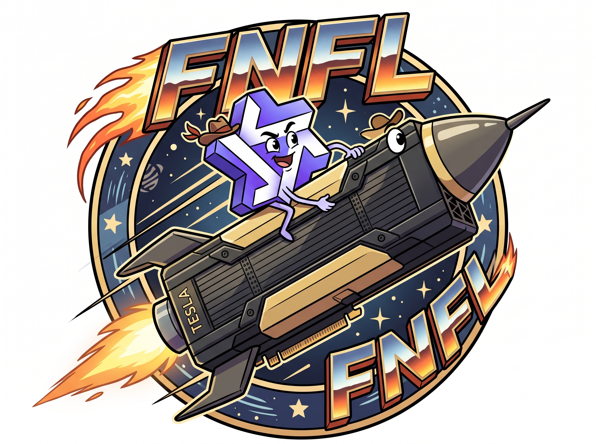

<p align="center">

</p>

# FNFL: Qwen3.8-Flash-Next on Tesla V100s

This is a from scratch inference engine that runs on 1, 2 or 4 Tesla V100 GPUs (four across two machines). It supports exactly one model, Qwen Flash Next 3.8, and has been tested on exactly two quants: the ISTA-DASLab IQ3_XXS 3-bit quant on one machine, and Unsloth's UD-Q4_K_XL 4-bit quant across two machines. If this interests you, you are in luck! I have written what I think is the fastest runtime for this model on these cards I know about. Every single decision and design choice was built around the V100 from the ground up. Why should you care? It is really, really fast at decoding and making tokens :)  

I did not trade quality for speed in our implementation.  I used llama.cp as the reference, and FNFL matches it as closely as llama.cpp matches itself. Output distribution good. 

Oh, and, FNFL stands for "Flash Next For Life". 

# Current Features

- MoE Caching with strong performance matching Strata-V100
  - Supports 16GB or 32GB cards
- Multiple concurrent users: up to four on one machine, eight on two
- Two machines with two V100s each, serving the 4-bit Q4 quant (new in 0.4)
- Image input, JPEG and PNG (new in 0.4)
- Long prompts read while other users keep generating (new in 0.4)
- Fast decode and prompt reading at full context depth

## Why should you care?

These are PCIe cards:  

- Engine ran at 218 t/s **average** at depth across nine hours of DeepSWE
- 0.2 ran a whole DeepSWE task (sql-formatter, resolved) at 211 t/s average decode and 2,300 t/s prefill
- 0.4 ran the same task end to end again, resolved, at 209 t/s decode and 2,738 t/s prefill
- ENGINE IS NOT AFRAID OF DEEP CONTEXT, Ran at 262K
- Reads prompts at about 3,600 t/s, a 131k token prompt took 36.2 seconds to load
- Barely moved at depth, 3,391 tokens added to ~196k context took 1.28 seconds
- Stable enough to run DeepSWE 1.1 all night without leaking or crashing
- This quant solves DeepSWE at the same rate as the full quant in my single full bench
- MoE cache on ONE card solved the same DeepSWE task: 79 t/s on a 32GB card, 48 t/s on a 16GB card
- Up to eight users on two machines with four V100s: 560 t/s together on vLLM's own serving bench (new in 0.4)
- What each release added is under [Changes](#changes), and [0.3 against 0.4](#03-against-04) puts the two side by side

I care about agentic coding, so that is what I had time to bench so far. It's still fast on other stuff. It may not be as smart, but this quant has proven strong. 

## Changes

**0.4**
- Two machines with two V100s each are now the production setup. They serve Unsloth's `UD-Q4_K_XL` 4-bit quant to up to eight users, and they run on machines other than the development ones, since the second machine now takes its model path. The link uses RoCE when its checks pass and TCP otherwise. See [Two machines](#two-machines).
- Image input, JPEG and PNG, with the model's vision projector (`--mmproj`).
- Long prompts are read while other users keep generating, aiming to keep each generating user's next step within 100 ms (`--fnfl-writer-pause-ms`).
- Faster prompt reading, with kernels picked for each prompt's length from a measured table.
- Per-request `ignore_eos`, and the `fnfl-bench` bench runner in `fn/tools/`.
- The scripts' and tools' default paths are under the home directory.

**0.3**
- Several users decode together at any draft depth, and faster: four writers went from 272 to 335 t/s together. The default draft depth is now 2.
- Experimental: the model split across two machines with two V100s each, on the development machines only.
- The build needs UCX (`libucx-dev`).

**0.2**
- Up to four users at once (`-np 1` to `-np 4`), with `-c` as a KV pool they share.
- The 8-bit KV cache by default.
- The expert cache (experimental), for one card or two 16 GB cards.

## 0.3 against 0.4

Two 32 GB cards with the IQ3_XXS quant, on the test machine (Ryzen 5 5600, PCIe 3.0 x8 per card), one run per point. A second machine with PCIe x16 and an i9-9900K ran the same 0.4 points 1 to 5% faster.

| | 0.3 | 0.4 | Notes |
| --- | --- | --- | --- |
| One user, poetry, draft depth 2 | 219.8 t/s | 223.8 t/s | greedy, short context |
| One user, poetry, draft depth 4 | 225.5 t/s | 229.3 t/s | greedy, short context |
| A lone 64K-token prompt | about 3,600 t/s (an earlier release) | 3,655 t/s | the older figure is from the synthetic prefill bench below |
| Four short writers together, greedy | 334.8 t/s | not rerun | |
| Four users about 64K deep, together | 144.5 t/s | not rerun | |
| DeepSWE sql-formatter, one agent, whole task | 211 t/s decode, 2,305 prefill (0.2) | 208.8 t/s decode, 2,738 prefill, resolved | draft depth 4; 0.3 was not run |
| HumanEval+, one request at a time | 247.6 t/s a reply (0.1, 47 problems) | 248.2 t/s a reply, all 164 | draft depth 4, thinking on |
| Two machines, Q4 | experimental, development machines only | 187 / 420 / 560 t/s at 1 / 4 / 8 users | vLLM's serving bench |

On vLLM's serving bench (random tokens, greedy, draft depth 2), 0.4 on two cards wrote 226 t/s for one user and 333 t/s together for four, and its first token on a 2,048-token prompt came in 676 ms. 0.3 was not run on that bench.

## Benchmaxx Metrics

Who doesn't love some benchmaxx metrics that make their engine look good? 

**Synthetic t/s decode**

312 t/s copying a source file word for word with almost 5 tokens per round.   
298 t/s writing new code with greedy sampling jotting down a red-black tree and unit test with 4.53 t/s. Opus said it wrote something resembling code, good enough for a benchmaxx.  
(Both on 0.1 at draft depth 4, thinking off.)

**HumanEval:**

248 t/s per reply across all 164 HumanEval+ problems on 0.4 (two cards, draft depth 4, temperature 1.0, thinking on, one request at a time). 161 of 164 pass the base tests and 157 of 164 the plus tests.

**A whole DeepSWE task, one agent (0.4):**

sql-formatter resolved, all 5,735 tests passing, in 102 turns and up to 122K tokens of context: 209 t/s decode and 2,738 t/s prefill (two cards, draft depth 4).

**Four users at once (new in 0.2):**

272 t/s together, about 70 t/s each, with four users writing at once with greedy sampling (short prompts).  
258 t/s together at temperature 1.0.  
A lone user is not slowed by having four slots open, and every user gets the same tokens it would get alone.

**Four users at once (0.3):**

335 t/s together with four users writing at once with greedy sampling, at draft depth 2 (355 t/s at depth 3; 0.2 was 272).  
145 t/s together with four users each about 64K tokens deep.  
One user alone is unchanged: 220 t/s at depth 2, 225 at depth 4.  
To get there the shared step does some of its math in 16-bit on the tensor cores, so a user's tokens can now drift from what it would get alone after the first hundred or so. A lone user still runs the exact single-user path.

**Two machines, Q4, vLLM's serving bench (new in 0.4):**

vLLM's `bench serve` client and random dataset, ported as is, greedy with `ignore_eos`, on the four-card split. Random tokens make the draft's guesses land less often (42 to 73% here) than on real text, so real use runs faster.

- One user, 128 tokens in and 2,048 out: 187 t/s, 4.45 ms a token, first token in 128 ms
- Four users: 420 t/s together
- Eight users: 560 t/s together, about 12 ms a token each
- Eight users, 2,048 in and 2,048 out: 458 t/s together
- One user, a 2,048-token prompt: first token in 747 ms

On real text one user gets about 198 t/s on poetry with greedy sampling, and 170 to 175 t/s on everyday requests at temperature 1.0. A lone 64K-token prompt reads at 5,240 to 5,650 t/s, and four 64K prompts at once at about 5,700 to 6,150 t/s together.

**MoE cache, one card, a whole DeepSWE task (sql-formatter, solved):**

32GB card: 79 t/s decode, 346 t/s prefill  
16GB card: 48 t/s decode, 173 t/s prefill  
KV in host RAM, dev builds right before 0.2. On a 32GB card KV on the card is a bit faster (106 t/s vs 102 on poetry).

**Synthetic prefill:**

Startup costs not really factored out at all.  

- 512 tokens: 1,381 tok/s
- 2K: 2,396 tok/s
- 8K: 3,053 tok/s
- 32K: 3,577 tok/s
- 128K: 3,623 tok/s, in 36.2 s
- 255K (a full context): 3,545 tok/s, in 73.7 s

## Caveat Emptor

There are probably a billion sharp edges in this build and this is a preview release that basically is meant to show what is possible. You probably have a lot of questions about how fast it might be for say an MoE cached 16GB card on a system with a lot of RAM. I have those same questions. A lot of things you might expect that I didn't think about are probably just straight up missing. A lot of things have zero options to tune to your workload or environment.

# Why did I do this? 

I reviewed the hardware specs and ran simulator figures that said this was possible and that no build I could find anywhere was running these cards anywhere close to their theoretical capacity so I was curious how far I could get reading research papers, analyzing code, and telling agents "MORE!". I accidentally learned a good bit about Volta GPU programming and how modern models are designed. Oops. 

# How to get in touch?

Start a discussion. 

# What if I have an issue / pull request

You can create an issue. If it is relevant to the project's goals I might work on it. If you have a pull request I am pretty unlikely to look at it unless it is relevant to the project's goals :)

# The rest of the README

It is deliberately narrow. It runs one model in two quantizations, one draft head, one pair of GPUs (or two pairs on two machines) and up to four conversations at a time (eight on two machines). Anything else is refused when the server starts or when a request arrives. If you have that machine, this should be the fastest way to run this model on it. Here is what to know:

- It runs exactly the one model
- 2xV100 32GB, or two machines with 2xV100 32GB each
- One to four users at once on one machine (`-np 1` to `-np 4`), up to eight on two; one user alone gets the fastest replies
- Standard OpenAI HTTP inference endpoint

I intend to support other quants and configurations of this model. 

This repository began as a fork of llama.cpp. Upstream llama.cpp's own README is at [ggml-org/llama.cpp](https://github.com/ggml-org/llama.cpp). Very little of llama.cpp is left. 

## What it runs (okay Opus)

- **Target model:** ISTA-DASLab's GSQ-RCO `IQ3_XXS` quantization of Qwen3.8-Flash-Next, two GGUF shards, 75.8 GB in all.
  - It is mixed-bit despite its name. The routed experts' gate and up weights use five 2- and 3-bit formats that change layer by layer (IQ3_XXS in only 6 of the 48 layers), their down weights are Q2_0 or IQ4_NL, and the rest of the model is kept at higher precision.
  - The server checks the file's architecture (`qwen4exp`) and shapes at load and refuses any other model.
- **On two machines:** Unsloth's `UD-Q4_K_XL` quantization of the same model, four GGUF shards, 111 GB in all. Unsloth's vision projector, `mmproj-BF16.gguf` (0.9 GB) from the same repository, adds image input on either setup.
- **Draft model:** Unsloth's shared MTP head, `mtp-Qwen3.8-Flash-Next-shared-Q8_0.gguf` (2.79 GB). The draft is required, since speculative decoding is the only decode path.
- **Context:** up to 262,144 tokens a conversation. With more than one user, `-c` is a pool the users share (409,600 tokens fits four users), and each conversation can still grow to 262,144.
- **Several users:** up to four conversations decode together in one step on both cards, which is where the extra throughput comes from. On two machines up to eight run as two groups, so each machine works on one group while the other works on the other. A lone user gets the exact single-user path. Users decoding together share a step that does some products in 16-bit on the tensor cores, so their tokens can drift from what each would get alone after the first hundred or so; measured as KL against a lone user, that difference is a little larger than the 8-bit KV cache's.
- **KV cache:** 8-bit (int8 with a scale every 64 values) by default: about 2.5 GiB a card at the full 262,144 tokens instead of 3.9. It passed the same KL bounds the rest of the engine is held to against llama.cpp. `--fnfl-kv-format bf16` selects the 16-bit cache.
- **Sampling:** temperature, top-k (1 to 256), top-p and min-p, with the model's recommended defaults (T 1.0, top-k 20, top-p 0.95, min-p 0.05). Speculative decoding samples exactly from the model's own distribution.

## Requirements

- **Two Tesla V100 32 GB cards** (Volta, `sm_70`) that can reach each other peer to peer. Check with `nvidia-smi topo -p2p r`.
  - It has been built and run on two PG500-216 32 GB cards on PCIe 3.0 x8 each, with no NVLink.
  - 16 GB cards do not fit the two-card engine, since each card holds 23.2 GiB of weights. With four users and `-c 409600`, each 32 GB card has about 0.57 GiB to spare after load, and about 0.2 GiB once the multi-user graphs are captured.
  - The experimental expert cache also runs on one card, or on two 16 GB cards (see [Which setup for your cards](#which-setup-for-your-cards)).
- **On AMD platforms, boot with `iommu=pt`.** On the test machine, peer access between the cards worked only after that boot setting.
- **NVIDIA driver 580.** That series is the last to support Volta.
- **CUDA 12.x**, with 12.8 tested. CUDA 13 dropped `sm_70`.
- **Linux** (Ubuntu 26.04 tested), GCC/G++ 14, CMake (4.2 tested), Ninja and Python 3. The OpenSSL development headers are optional; without them the server builds without HTTPS.
- **UCX** (`libucx-dev` on Ubuntu), new in 0.3. The link between two machines uses it, and the build needs it even for one machine.
- **Host memory:** 128 GB tested.
  - The model files are memory-mapped.
  - The model's per-layer embedding table (26.9 GiB) stays in host memory and is read a few rows per token.
- **Disk:** about 80 GB for the IQ3_XXS files, or about 115 GB for the Q4 files with the draft and the vision projector.
- **For two machines:** two machines that each meet the requirements above, linked by an `mlx5` network adapter, with:
  - the same build and the same model path on both;
  - `iommu=pt` on both;
  - ssh from the first machine to the second, which the launch script uses to start the second.

  The link uses RoCE when its checks pass on both machines, and TCP otherwise.
- **Cooling:** the passively cooled V100 needs forced airflow through its fins. Decode keeps both cards busy for as long as a reply lasts.

## Quick start

### 1. Get the model files

```sh
hf download ISTA-DASLab/Qwen3.8-Flash-Next-GSQ-RCO-GGUF --include "IQ3_XXS/*" --local-dir models/flash-next
hf download unsloth/Qwen3.8-Flash-Next-GGUF MTP/mtp-Qwen3.8-Flash-Next-shared-Q8_0.gguf --local-dir models/flash-next
```

### 2. Build

```sh
cmake --preset fnfl -DLLAMA_UI_ARCHIVE= -DLLAMA_UI_ARCHIVE_SHA256=
ninja -C build-fnfl llama-server fnfl-drive
```

- The `fnfl` preset names `gcc-14`, `g++-14` and `/usr/local/cuda-12.8/bin/nvcc`. Override them on the command line if yours are elsewhere.
- The preset also expects a pinned web-UI archive under the builder's home directory. The two empty `LLAMA_UI_*` settings turn that off, so the build tries to download the prebuilt UI instead. If that download fails, the server builds without the web UI, and the API is unaffected.
- [`docs/fnfl/build.md`](docs/fnfl/build.md) has the details.

### 3. Run

```sh
build-fnfl/bin/llama-server --host 127.0.0.1 --port 8190 -np 1 --jinja \
-m models/flash-next/IQ3_XXS/Qwen3.8-Flash-Next-GSQ-RCO-IQ3_XXS-00001-of-00002.gguf \
-md models/flash-next/MTP/mtp-Qwen3.8-Flash-Next-shared-Q8_0.gguf \
--fnfl-draft-subset models/draft-vocab-qwen3.8-flash-next.txt \
-c 262144 --fnfl-spec-d 2 --fnfl-draft-attention sparse
```

- The server finds the second shard by name.
- `--fnfl-draft-subset` names the draft's 65,536-token vocabulary list. That file ships in this repository.
- The last line gives the model's full context and the settings the project serves with: two draft proposals a step ([Draft depth](#draft-depth)) and sparse draft attention.
- Startup prints the memory left on each card and the engine's settings. The server is ready when it logs `listening on`.

For up to four users at once, change `-np 1` to `-np 4` and `-c 262144` to `-c 409600`:

```sh
build-fnfl/bin/llama-server --host 127.0.0.1 --port 8190 -np 4 --jinja \
-m models/flash-next/IQ3_XXS/Qwen3.8-Flash-Next-GSQ-RCO-IQ3_XXS-00001-of-00002.gguf \
-md models/flash-next/MTP/mtp-Qwen3.8-Flash-Next-shared-Q8_0.gguf \
--fnfl-draft-subset models/draft-vocab-qwen3.8-flash-next.txt \
-c 409600 --fnfl-spec-d 2 --fnfl-draft-attention sparse
```

- With more than one user, `-c` must be a multiple of 16,384 (the KV pool's page).
- Leaving `-np` out gives four slots.

### 4. Try it

```sh
curl -s http://127.0.0.1:8190/v1/chat/completions -H 'Content-Type: application/json' \
-d '{"messages":[{"role":"user","content":"Write a haiku about Volta."}],"max_tokens":512}'
```

The web UI is at `http://127.0.0.1:8190/` when the build embedded it. Any OpenAI-compatible client works against `/v1`, and Anthropic-style clients work against `/v1/messages`.

## Draft depth

`--fnfl-spec-d N` (1 to 4) sets how many tokens the draft head proposes each step. In 0.2 several users decoded together only at depth 4; in 0.3 they do at every depth.

**Use `--fnfl-spec-d 2`, the default, for several users and for agentic work.** Measured on the development machine with 0.3:

- Four DeepSWE agents on one server: 77.6 t/s each at depth 2, 74.1 at depth 3, 69.5 at depth 4 (the same task, the first five minutes of each run).
- Four users each about 64K tokens deep: 144.5 t/s together at depth 2, 142.6 at 3, 138.6 at 4.
- Four short writers, greedy: depth 3 is best, 355.4 t/s together, against 334.8 at depth 2 and 334.3 at depth 4.
- One user alone: 219.8, 227.3 and 225.5 t/s at depths 2, 3 and 4 at short context; at 64K of history about 183, 182 and 170, so depth 4 loses about 7% deep.

Checked again on 0.4 (two cards, the same machine), depth 2 against depth 4:

- One poetry writer: 223.8 against 229.3 t/s, so depth 4 is about 2% faster for one user on easy text.
- Four users on vLLM's serving bench: 332.9 against 317.3 t/s together (128 tokens in, 2,048 out), and 206.4 against 193.6 (128 in, 128 out).
- Three users about 64K deep: about 95 against 86 t/s each.

So depth 2 stays the default.

## Two machines

The production setup splits the model across two machines with two V100 32 GB cards each, linked by an `mlx5` network adapter. It serves Unsloth's `UD-Q4_K_XL` quantization to up to eight users at once:

```sh
fn/tools/fnfl-serve.sh start --split
```

- The first machine runs the server and layers 0 to 25; the second runs the rest, the output head and the draft.
- Defaults: 8 slots, 2 proposals a step with sparse draft attention, a shared 8-bit KV pool of 1,343,488 cells with up to 262,144 tokens a conversation, and a writers' pause of 100 ms: while another user's prompt is read, each machine aims to keep every generating user's next step within 100 ms of the last (a best-effort target).
- The link uses RoCE when the checks pass on both machines, and otherwise TCP, saying which check failed.
- Image input: start with `MMPROJ=/path/to/mmproj-BF16.gguf` (the model's vision projector) and send images as base64 data URLs in `image_url` parts, JPEG or PNG, up to 8 a request.

Get the files into the same place on both machines:

```sh
hf download unsloth/Qwen3.8-Flash-Next-GGUF --include "UD-Q4_K_XL/*" "MTP/*" "mmproj-BF16.gguf" --local-dir ~/models/Qwen3.8-Flash-Next-GGUF
```

The launch script is written for the development machines' layout: the build in `~/src/flashnext/engine` and the models under `~/models`. These environment variables override it:
- `MODEL` and `MMPROJ`: the model and the projector;
- `BIN`: the server binary;
- `FOLLOWER` and `FOLLOWER_ADDR`: the second machine's ssh name and its address on the link;
- `FOLLOWER_DIR`, `SERVE_DIR` and `PORT`.

The draft, its vocabulary list and the GPU-lock directory are fixed in the script, so on other machines treat it as a template.

Measured speeds are under [Benchmaxx Metrics](#benchmaxx-metrics). [`docs/fnfl/server.md`](docs/fnfl/server.md#two-machines-the-production-launch) has the defaults, the link's checks, the refusals and the switches.

## What it does not do

- Any other model, quantization or draft head, or any GPU other than V100s in the setups described here.
- More than four requests at a time on one machine (`-np` is 1 to 4), or more than eight on two. Further requests wait for a free slot.
- Embeddings, reranking or LoRA adapters. The server refuses to start with them.
- Audio or video input, images from remote URLs, or image formats other than JPEG and PNG. Such requests are refused.
- Per request:
  - repetition, frequency or presence penalties
  - `logit_bias`
  - log-probabilities
  - `n > 1`
  - DRY, XTC, typical-p, mirostat or dynamic temperature
  - a reasoning budget
  - a custom sampler order
  - top-k above 256 at a temperature above 0
  - constrained output: a grammar, a JSON schema, or `response_format` of type `json_object` or `json_schema`

  A request that asks for any of these is refused with a message naming it. Tool calls work; they are parsed from the model's text.

## Which setup for your cards

The two-card engine above keeps every weight on the cards. With less GPU memory, the expert cache (new in 0.2, experimental) keeps the routed experts in host memory, about 40 GiB page-locked, and holds the most used ones in a GPU cache. Experts that miss are copied over PCIe or computed on the CPU. It needs plenty of host RAM (128 GB tested) and serves one user (two on one card with `--fnfl-kv-host`).

What we measured on the test machine (Ryzen 5 5600, 6 cores; PCIe 3.0 x8 per card; 128 GB RAM), on development builds just before 0.2. "Poetry" is a long generated reply at shallow depth; "DeepSWE" is a whole coding-agent task run to completion, averaged over its depth.

- **Two 32 GB cards (the main engine):** 218 t/s poetry; DeepSWE 211 t/s decode, 2,305 t/s prefill (0.2, one agent, the whole task). With four users, about 240 to 272 t/s together. On 0.4: 224 t/s poetry, and the whole DeepSWE task at 209 t/s decode and 2,738 t/s prefill (see [0.3 against 0.4](#03-against-04)).
- **Two 16 GB cards:** `--fnfl-cached-tp`, KV on the cards: 107 t/s poetry, 2,176 t/s prefill on a 36K prompt. With the KV in host memory (`--fnfl-kv-host`), DeepSWE ran at 101 t/s decode and 483 t/s prefill.
- **One 32 GB card:** `--fnfl-single-card 0`, KV on the card: 106 t/s poetry, the fastest one-card setup. With `--fnfl-kv-host` instead: 102.5 t/s poetry; DeepSWE 79 t/s decode, 346 t/s prefill. Use `--fnfl-kv-host` only for two users on the card (`-np 2`) or when the KV does not fit.
  - For full speed on one 32 GB card, run at `-c 131072` and without `--mmproj`. The 262,144-token context takes about 2.8 GiB and the vision projector about 1.1 GiB of the card's expert cache: on 0.4 with both, poetry fell to about 82 t/s; at 131,072 tokens without vision it ran at 106.8 t/s.
- **One 16 GB card:** `--fnfl-single-card 0 --fnfl-kv-host`: about 59 t/s poetry; DeepSWE 48.5 t/s decode, 173 t/s prefill.

[`docs/fnfl/server.md`](docs/fnfl/server.md#the-expert-cache-experimental) has the exact commands and every expert-cache setting. The expert-cache setups use the 16-bit KV cache; the 8-bit format is refused there.

## Documentation

- [`docs/fnfl/build.md`](docs/fnfl/build.md): the toolchain, the preset and its overrides, the targets, and checking a build.
- [`docs/fnfl/server.md`](docs/fnfl/server.md): running the server, every argument that matters, the HTTP API, the startup and request logs, and the launch script.
- [`docs/fnfl/engine.md`](docs/fnfl/engine.md): how the engine works. It covers the model, the two-card layout, a decode step, prompt processing, memory, numerics and performance.
- [`docs/fnfl/fnfl-drive.md`](docs/fnfl/fnfl-drive.md): the developer driver, which runs engine pieces and the whole model without the server.
- [`fn/`](fn/): the engine source. [`fn/fnfl.h`](fn/fnfl.h) is the whole interface between the server and the engine.

## Credits and license

The server, tokenizer, chat templating and some CPU code come from [llama.cpp and ggml](https://github.com/ggml-org/llama.cpp) (MIT; see [`LICENSE`](LICENSE)). The model is [Qwen3.8-Flash-Next](https://huggingface.co/Qwen/Qwen3.8-Flash-Next) by the Qwen team. The IQ3_XXS quantization is by [ISTA-DASLab](https://huggingface.co/ISTA-DASLab/Qwen3.8-Flash-Next-GSQ-RCO-GGUF). The UD-Q4_K_XL quantization, the vision projector and the MTP head file are from [Unsloth](https://huggingface.co/unsloth/Qwen3.8-Flash-Next-GGUF). The model files carry their own licenses.
