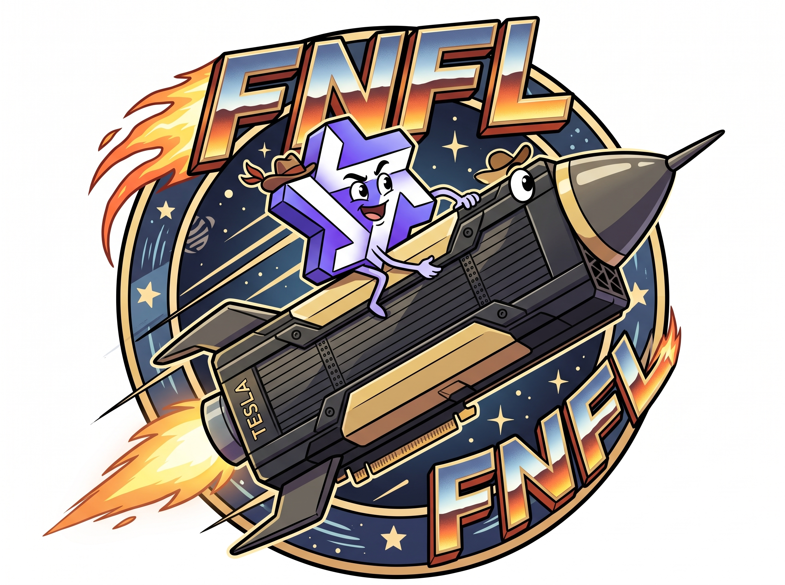

<p align="center">

</p>

# FNFL: Qwen3.8-Flash-Next on two Tesla V100s

This is a from scratch inference engine that runs on 2x32GB Tesla V100 GPU. It supports exactly one model and has been tested on exactly one quant. Qwen Flash Next 3.8 with the ISTA-DASLab IQ3_XXS 3-bit quant. This is a preview release, meaning I have barely tested it. If this interests you, you are in luck! I have written what I think is the fastest runtime for this model on these cards I know about. Every single decision and design choice was built around the V100 from the ground up. Why should you care? It is really, really fast at decoding and making tokens :)  

I did not trade quality for speed in our implementation.  I used llama.cp as the reference, and FNFL matches it as closely as llama.cpp matches itself. Output distribution good. 

Oh, and, FNFL stands for "Flash Next For Life".  

## Why should you care?

These are PCIe cards:  

- Engine ran at 218 t/s **average** at depth across nine hours of DeepSWE
- ENGINE IS NOT AFRAID OF DEEP CONTEXT, Ran at 262K
- Reads prompts at about 3,500 t/s, a 131k token prompt took 36.8 seconds to load
- Barely moved at depth, 3,391 tokens added to ~196k context took 1.28 seconds
- Stable enough to run DeepSWE 1.1 all night without leaking or crashing
- This quant solves DeepSWE at the same rate as the full quant in my single full bench
- New in 0.2: up to four users at once. Four DeepSWE agents on one server decoded at about 60 t/s each, about 240 t/s together, with no stalls or errors

I care about agentic coding, so that is what I had time to bench so far. It's still fast on other stuff. It may not be as smart, but this quant has proven strong. 

## Benchmaxx Metrics

Who doesn't love some benchmaxx metrics that make their engine look good? 

**Synthetic t/s decode**

314 t/s copying a source file word for word with almost 5 tokens per round.   
295 t/s writing new code with greedy sampling jotting down a red-black tree and unit test with 4.57 t/s. Opus said it wrote something resembling code, good enough for a benchmaxx.  

**HumanEval:**

250 t/s per reply on HumanEval

**Four users at once (new in 0.2):**

272 t/s together, about 70 t/s each, with four users writing at once with greedy sampling (short prompts).  
258 t/s together at temperature 1.0.  
A lone user is not slowed by having four slots open, and every user gets the same tokens it would get alone.

**Synthetic prefill:**

Startup costs not really factored out at all.  

- 512 tokens: 1,360 tok/s
- 2K: 2,343 tok/s
- 8K: 2,988 tok/s
- 32K: 3,519 tok/s
- 128K: 3,572 tok/s, in 36.7 s
- 255K (a full context): 3,493 tok/s, in 74.8 s

## Caveat Emptor

There are probably a billion sharp edges in this build and this is a preview release that basically is meant to show what is possible. You probably have a lot of questions about how fast it might be for say an MoE cached 16GB card on a system with a lot of RAM. I have those same questions. A lot of things you might expect that I didn't think about are probably just straight up missing. A lot of things have zero options to tune to your workload or environment.

# Why did I do this? 

I reviewed the hardware specs and ran simulator figures that said this was possible and that no build I could find anywhere was running these cards anywhere close to their theoretical capacity so I was curious how far I could get reading research papers, analyzing code, and telling agents "MORE!". I accidentally learned a good bit about Volta GPU programming and how modern models are designed. Oops. 

# How to get in touch?

Start a discussion. 

# What if I have an issue / pull request

You can create an issue. If it is relevant to the project's goals I might work on it. If you have a pull request I am pretty unlikely to look at it unless it is relevant to the project's goals :)

# The rest of the README

It is deliberately narrow. It runs one model file, one draft head, one pair of GPUs and up to four conversations at a time. Anything else is refused when the server starts or when a request arrives. If you have that machine, this should be the fastest way to run this model on it. Here is what to know:

- It runs exactly the one model
- 2xV100 32GB
- One to four users at once (`-np 1` to `-np 4`); one user alone gets the fastest replies
- Standard OpenAI HTTP inference endpoint

I intend to support other quants and configurations of this model. 

This repository began as a fork of llama.cpp. Upstream llama.cpp's own README is at [ggml-org/llama.cpp](https://github.com/ggml-org/llama.cpp). Very little of llama.cpp is left. 

## What it runs (okay Opus)

- **Target model:** ISTA-DASLab's GSQ-RCO `IQ3_XXS` quantization of Qwen3.8-Flash-Next, two GGUF shards, 75.8 GB in all.
  - It is mixed-bit despite its name. The routed experts' gate and up weights use five 2- and 3-bit formats that change layer by layer (IQ3_XXS in only 6 of the 48 layers), their down weights are Q2_0 or IQ4_NL, and the rest of the model is kept at higher precision.
  - The server checks the file's architecture (`qwen4exp`) and shapes at load and refuses any other model.
- **Draft model:** Unsloth's shared MTP head, `mtp-Qwen3.8-Flash-Next-shared-Q8_0.gguf` (2.79 GB). The draft is required, since speculative decoding is the only decode path.
- **Context:** up to 262,144 tokens a conversation. With more than one user, `-c` is a pool the users share (409,600 tokens fits four users), and each conversation can still grow to 262,144.
- **Several users:** up to four conversations decode together in one step on both cards, which is where the extra throughput comes from. Every user gets exactly the tokens it would get alone.
- **KV cache:** 8-bit (int8 with a scale every 64 values) by default: about 2.5 GiB a card at the full 262,144 tokens instead of 3.9. It passed the same KL bounds the rest of the engine is held to against llama.cpp. `--fnfl-kv-format bf16` selects the 16-bit cache.
- **Sampling:** temperature, top-k (1 to 256), top-p and min-p, with the model's recommended defaults (T 1.0, top-k 20, top-p 0.95, min-p 0.05). Speculative decoding samples exactly from the model's own distribution.

## Requirements

- **Two Tesla V100 32 GB cards** (Volta, `sm_70`) that can reach each other peer to peer. Check with `nvidia-smi topo -p2p r`.
  - It has been built and run on two PG500-216 32 GB cards on PCIe 3.0 x8 each, with no NVLink.
  - 16 GB cards do not fit the two-card engine, since each card holds 23.2 GiB of weights. With four users and `-c 409600`, each 32 GB card has about 0.57 GiB to spare after load, and about 0.2 GiB once the multi-user graphs are captured.
  - The experimental expert cache also runs on one card, or on two 16 GB cards (see [Which setup for your cards](#which-setup-for-your-cards)).
- **On AMD platforms, boot with `iommu=pt`.** On the test machine, peer access between the cards worked only after that boot setting.
- **NVIDIA driver 580.** That series is the last to support Volta.
- **CUDA 12.x**, with 12.8 tested. CUDA 13 dropped `sm_70`.
- **Linux** (Ubuntu 26.04 tested), GCC/G++ 14, CMake (4.2 tested), Ninja and Python 3. The OpenSSL development headers are optional; without them the server builds without HTTPS.
- **Host memory:** 128 GB tested.
  - The model files are memory-mapped.
  - The model's per-layer embedding table (26.9 GiB) stays in host memory and is read a few rows per token.
- **Disk:** about 80 GB for the model files.
- **Cooling:** the passively cooled V100 needs forced airflow through its fins. Decode keeps both cards busy for as long as a reply lasts.

## Quick start

### 1. Get the model files

```sh
hf download ISTA-DASLab/Qwen3.8-Flash-Next-GSQ-RCO-GGUF --include "IQ3_XXS/*" --local-dir models/flash-next
hf download unsloth/Qwen3.8-Flash-Next-GGUF MTP/mtp-Qwen3.8-Flash-Next-shared-Q8_0.gguf --local-dir models/flash-next
```

### 2. Build

```sh
cmake --preset fnfl -DLLAMA_UI_ARCHIVE= -DLLAMA_UI_ARCHIVE_SHA256=
ninja -C build-fnfl llama-server fnfl-drive
```

- The `fnfl` preset names `gcc-14`, `g++-14` and `/usr/local/cuda-12.8/bin/nvcc`. Override them on the command line if yours are elsewhere.
- The preset also expects a pinned web-UI archive at a path on the test machine. The two empty `LLAMA_UI_*` settings turn that off, so the build tries to download the prebuilt UI instead. If that download fails, the server builds without the web UI, and the API is unaffected.
- [`docs/fnfl/build.md`](docs/fnfl/build.md) has the details.

### 3. Run

```sh
build-fnfl/bin/llama-server --host 127.0.0.1 --port 8190 -np 1 --jinja \
-m models/flash-next/IQ3_XXS/Qwen3.8-Flash-Next-GSQ-RCO-IQ3_XXS-00001-of-00002.gguf \
-md models/flash-next/MTP/mtp-Qwen3.8-Flash-Next-shared-Q8_0.gguf \
--fnfl-draft-subset models/draft-vocab-qwen3.8-flash-next.txt \
-c 262144 --fnfl-spec-d 4 --fnfl-draft-attention sparse
```

- The server finds the second shard by name.
- `--fnfl-draft-subset` names the draft's 65,536-token vocabulary list. That file ships in this repository.
- The last line gives the model's full context and the settings the project serves with: four draft proposals a step and sparse draft attention.
- Startup prints the memory left on each card and the engine's settings. The server is ready when it logs `listening on`.

For up to four users at once, change `-np 1` to `-np 4` and `-c 262144` to `-c 409600`:

```sh
build-fnfl/bin/llama-server --host 127.0.0.1 --port 8190 -np 4 --jinja \
-m models/flash-next/IQ3_XXS/Qwen3.8-Flash-Next-GSQ-RCO-IQ3_XXS-00001-of-00002.gguf \
-md models/flash-next/MTP/mtp-Qwen3.8-Flash-Next-shared-Q8_0.gguf \
--fnfl-draft-subset models/draft-vocab-qwen3.8-flash-next.txt \
-c 409600 --fnfl-spec-d 4 --fnfl-draft-attention sparse
```

- With more than one user, `-c` must be a multiple of 16,384 (the KV pool's page).
- Leaving `-np` out gives four slots.

### 4. Try it

```sh
curl -s http://127.0.0.1:8190/v1/chat/completions -H 'Content-Type: application/json' \
-d '{"messages":[{"role":"user","content":"Write a haiku about Volta."}],"max_tokens":512}'
```

The web UI is at `http://127.0.0.1:8190/` when the build embedded it. Any OpenAI-compatible client works against `/v1`, and Anthropic-style clients work against `/v1/messages`.

## What it does not do

- Any other model, quantization or draft head, or any GPU other than a V100 pair.
- More than four requests at a time (`-np` is 1 to 4). Further requests wait for a free slot.
- Embeddings, reranking, multimodal input or LoRA adapters. The server refuses to start with them.
- Per request:
  - repetition, frequency or presence penalties
  - `logit_bias`
  - log-probabilities
  - `n > 1`
  - DRY, XTC, typical-p, mirostat or dynamic temperature
  - a reasoning budget
  - a custom sampler order
  - top-k above 256 at a temperature above 0
  - constrained output: a grammar, a JSON schema, or `response_format` of type `json_object` or `json_schema`

  A request that asks for any of these is refused with a message naming it. Tool calls work; they are parsed from the model's text.

## Which setup for your cards

The two-card engine above keeps every weight on the cards. With less GPU memory, the expert cache (new in 0.2, experimental) keeps the routed experts in host memory, about 40 GiB page-locked, and holds the most used ones in a GPU cache. Experts that miss are copied over PCIe or computed on the CPU. It needs plenty of host RAM (128 GB tested) and serves one user (two on one card with `--fnfl-kv-host`).

What we measured on the test machine (Ryzen 5 5600, 6 cores; PCIe 3.0 x8 per card; 128 GB RAM), on development builds just before 0.2. "Poetry" is a long generated reply at shallow depth; "DeepSWE" is a whole coding-agent task run to completion, averaged over its depth.

- **Two 32 GB cards (the main engine):** 218 t/s poetry; DeepSWE 208 t/s decode, 1,573 t/s prefill. With four users, about 240 to 272 t/s together.
- **Two 16 GB cards:** `--fnfl-cached-tp`, KV on the cards: 107 t/s poetry, 2,176 t/s prefill on a 36K prompt. With the KV in host memory (`--fnfl-kv-host`), DeepSWE ran at 101 t/s decode and 483 t/s prefill.
- **One 32 GB card:** `--fnfl-single-card 0`, KV on the card: 106 t/s poetry, the fastest one-card setup. With `--fnfl-kv-host` instead: 102.5 t/s poetry; DeepSWE 79 t/s decode, 346 t/s prefill. Use `--fnfl-kv-host` only for two users on the card (`-np 2`) or when the KV does not fit.
- **One 16 GB card:** `--fnfl-single-card 0 --fnfl-kv-host`: about 59 t/s poetry; DeepSWE 48.5 t/s decode, 173 t/s prefill.

[`docs/fnfl/server.md`](docs/fnfl/server.md#the-expert-cache-experimental) has the exact commands and every expert-cache setting. The expert-cache setups use the 16-bit KV cache; the 8-bit format is refused there.

## Documentation

- [`docs/fnfl/build.md`](docs/fnfl/build.md): the toolchain, the preset and its overrides, the targets, and checking a build.
- [`docs/fnfl/server.md`](docs/fnfl/server.md): running the server, every argument that matters, the HTTP API, the startup and request logs, and the launch script.
- [`docs/fnfl/engine.md`](docs/fnfl/engine.md): how the engine works. It covers the model, the two-card layout, a decode step, prompt processing, memory, numerics and performance.
- [`docs/fnfl/fnfl-drive.md`](docs/fnfl/fnfl-drive.md): the developer driver, which runs engine pieces and the whole model without the server.
- [`fn/`](fn/): the engine source. [`fn/fnfl.h`](fn/fnfl.h) is the whole interface between the server and the engine.

## Credits and license

The server, tokenizer, chat templating and some CPU code come from [llama.cpp and ggml](https://github.com/ggml-org/llama.cpp) (MIT; see [`LICENSE`](LICENSE)). The model is [Qwen3.8-Flash-Next](https://huggingface.co/Qwen/Qwen3.8-Flash-Next) by the Qwen team. The quantization is by [ISTA-DASLab](https://huggingface.co/ISTA-DASLab/Qwen3.8-Flash-Next-GSQ-RCO-GGUF), and the MTP head file is from [Unsloth](https://huggingface.co/unsloth/Qwen3.8-Flash-Next-GGUF). The model files carry their own licenses.
